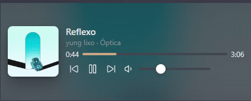

# Bard Player

Music streaming player for [Obsidian](https://obsidian.md): a full player view, a mini player (dock, popout or floating always-on-top window), Windows taskbar buttons and media-key integration.



> **Desktop only.** Bard Player relies on Electron's `<webview>` and is not available on mobile.
>
> **Compatibility and trademarks.** Bard Player embeds the official YouTube Music web app; it does not block ads or download content. It is not affiliated with, endorsed by or sponsored by YouTube or Google. "YouTube" and "YouTube Music" are trademarks of Google LLC.

## Status

Version 1.0.0. See [docs/PLAN.md](docs/PLAN.md) for the roadmap.

- **Player view** (ribbon icon or the "Open player" command): the full web player in a tab.
- **Mini player** ("Open mini player"): compact controls to dock in a sidebar, a split or a popout.
- **Windows taskbar buttons** (previous / play-pause / next) and media keys.

### Where is my login stored?

Sign-in happens inside the player view. Cookies live in an Electron persistent partition
(`persist:bard-player`) under Obsidian's app data folder (`%APPDATA%\obsidian\Partitions\bard-player`
on Windows), **never inside your vault**, so vault sync and backups do not carry your login session.

## Development

```
npm install
npm run build   # type-check, bundle main.js, copy to vault if .env.local sets OBSIDIAN_PLUGIN_DIR
npm run lint
```

See [CONTRIBUTING.md](CONTRIBUTING.md).

## License

[GPL-3.0](LICENSE)
